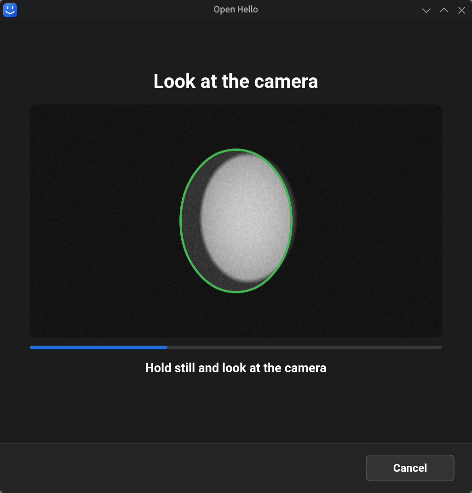
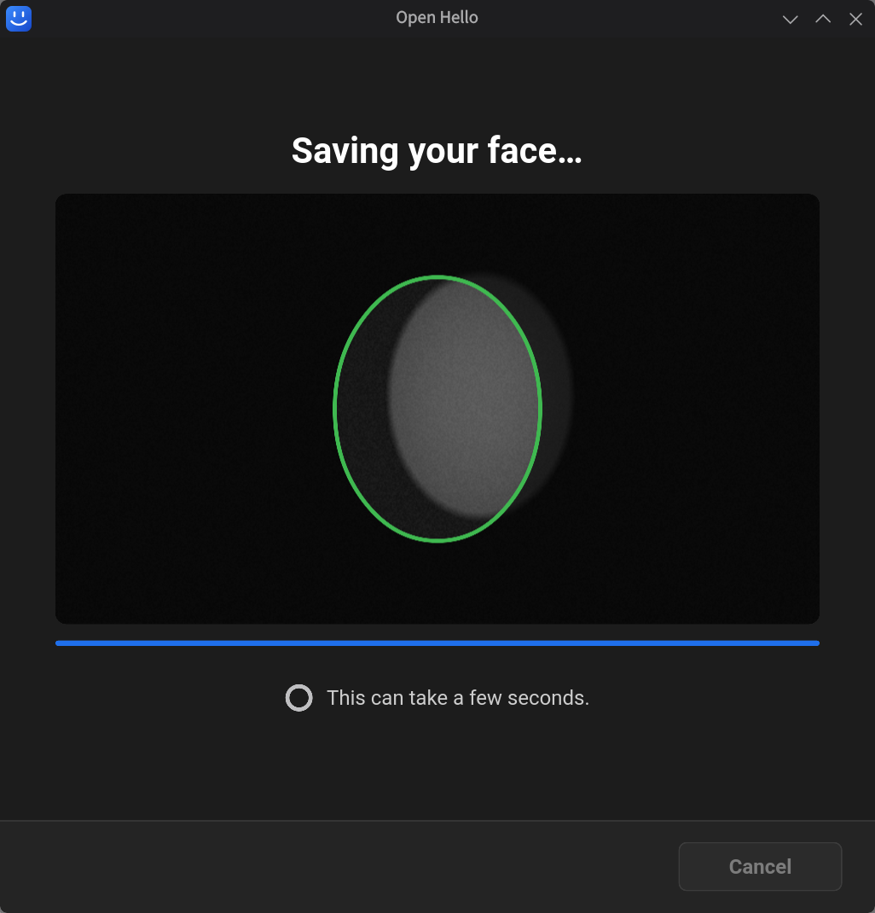
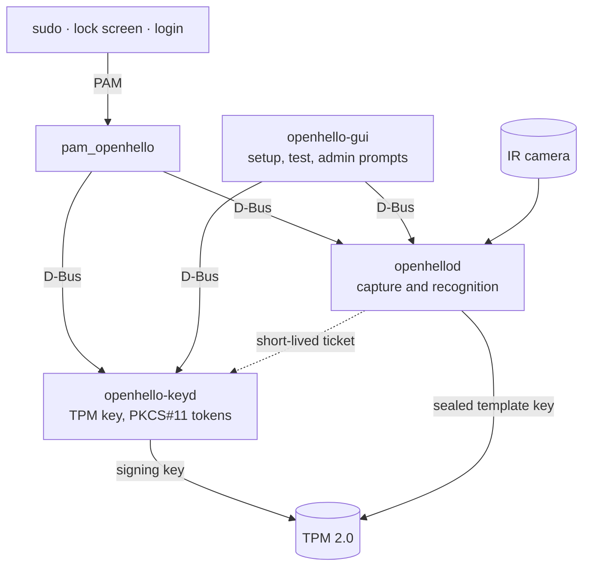

# open-hello

Face login for Linux, modeled on Windows Hello: your face authorizes the use of a key held in the TPM, instead of being treated like a password.

It works with `sudo`, the lock screen and any service that authenticates through PAM. If the face is not recognized, the system asks for the password as usual.

## Requirements

- An infrared (IR) camera exposed as a V4L2 node, the "Windows Hello certified" kind.
- TPM 2.0.
- Linux (x86_64) with systemd, D-Bus and PAM. No dependency on a specific distribution or desktop environment.

The packages declare their own dependencies (`tpm2-tools`, `tpm2-pkcs11`, `polkit` and others), and the package manager installs them.

## Installation

Download the package for your distribution from the [latest release](https://github.com/eduresser/open-hello/releases/latest) and install it with the package manager:

| Distribution | Package | Command |
|---|---|---|
| Debian, Ubuntu | `openhello_<version>-1_amd64.deb` | `sudo apt install ./openhello_*.deb` |
| Fedora, RHEL and derivatives | `openhello-<version>-1.x86_64.rpm` | `sudo dnf install ./openhello-*.rpm` |
| openSUSE | `openhello-<version>-1.x86_64.rpm` | `sudo zypper install --allow-unsigned-rpm ./openhello-*.rpm` |
| Arch Linux | `openhello-<version>-1-x86_64.pkg.tar.zst` | `sudo pacman -U ./openhello-*.pkg.tar.zst` |

The packages are not signed. To check the download, compare it with the `SHA256SUMS` file of the release: `sha256sum -c --ignore-missing SHA256SUMS`.

Installing the package:

- installs the services, the models and ONNX Runtime, and starts the daemons;
- enables the PAM module in the common authentication stack on the first install, and keeps your choice on upgrades;
- lets the administrator who ran the install use their own face or password for `sudo` and `pkexec` where the distribution asks for the root password;
- loads the SELinux module when SELinux is enabled.

After installing, set `OPENHELLO_DEVICE` in `/etc/openhello/openhello.env` to your IR camera node (the default is `/dev/video2`), restart the services with `sudo systemctl restart openhellod openhello-keyd`, and open **Open Hello** to enroll your face.

To remove, use the package manager (`sudo apt remove openhello`, `sudo dnf remove openhello`, `sudo zypper remove openhello` or `sudo pacman -R openhello`). Removal disables the PAM module and the services. Run `openhello-cli purge` before removing if you also want to erase your face data and the key.

### From source

Use the script on a distribution without a package, or to run a build from the repository. It needs `tpm2-tools`, `tpm2-pkcs11` (PKCS#11 module and `tpm2_ptool`), `polkit` and a C compiler; it checks each item and lists what is missing, but does not install packages.

```bash
sudo scripts/install.sh
```

The script builds the project, downloads the models and ONNX Runtime with checksum verification, installs the services and enables the PAM module in the common authentication stack. Do not mix it with the package: the package warns when a copy from the script is still in `/usr/local/bin`.

The face recognition window is optional: when the fontconfig and FreeType development files are installed, the script also builds it and installs the `openhello-gui` command and a menu entry; otherwise it skips the window, names the packages to install for your distribution, and everything else works.

Options:

| Option | Effect |
|---|---|
| `--dry-run` | Shows what would be done without changing the system |
| `--skip-checks` | Skips the requirements check |
| `--no-pam` | Installs without enabling PAM |
| `--no-gui` | Skips the face recognition window |

## Face recognition window

Open **Open Hello** from the application menu, or run `openhello-gui`.

<p align="center">
  
  
  
</p>
<p align="center">
  
  
</p>

1. **Get started** asks for your password once, through polkit.
2. Look at the camera. The oval turns green when a sample is accepted, and the bar shows the progress.
3. After the last sample, the window shows **Saving your face…** while the face is stored and the login key is created in the TPM. This can take a few seconds.
4. **Test** checks that the face is recognized. The result appears below the text: green when it worked, red with the reason when it did not.

The main screen, shown whenever a face is set up, offers **Test**, **Set up again** and **Delete face data**.

**Use my face for admin prompts.** Some distributions, such as openSUSE, make `sudo` and `pkexec` ask for the root password; a face cannot answer that prompt. On those systems the window shows a switch, after setup and on the main screen:

- On: OpenHello adds a sudoers drop-in and a polkit rule for your user only, so admin prompts accept your face or your own password.
- Off: both files are removed and admin prompts ask for the root password again.

Each change asks for administrator authentication. If the prompt is closed or refused, the switch stays where it was and the reason is shown. Deleting the face data also turns it off. The switch is hidden where `sudo` already asks for your own password.

Demo mode runs the window without a camera, TPM or daemon: `openhello-gui --demo` (add `--demo-enrolled` for the main screen, `--demo-sudo` for the switch). When a click seems to be lost, run `openhello-gui --trace-input` and send the lines it prints on stderr: each pointer event, button click, worker command and screen change with its time in milliseconds, and no image data.

## Usage

```bash
openhello-cli enroll        # enroll your face
openhello-cli verify        # test recognition
openhello-cli identify      # identify who is in front of the camera
openhello-cli purge         # erase biometric data and the key

sudo openhello-cli pam status    # show where the module is enabled
sudo openhello-cli pam enable    # enable in the common authentication stack
sudo openhello-cli pam disable   # undo

sudo openhello-cli admin status UID         # whose password sudo and pkexec ask for
sudo openhello-cli admin own-password UID   # same as turning the window switch on
sudo openhello-cli admin restore UID        # same as turning it off
```

Enroll from an active graphical session: polkit requires a local session to authorize the operation.

## Attempt policy

Each authentication request gets up to 3 recognition attempts within 10 seconds. After that, the system asks for the password. There is no persistent lockout.

## How it works



- **`openhellod`**: captures frames from the IR camera, extracts the face embedding and compares it with the enrolled templates. It never touches the key.
- **`openhello-keyd`**: holds one ECDSA P-256 key per user, created inside the TPM and non-exportable. It never sees biometric data.
- **Ticket**: after a successful recognition, `openhellod` issues a signed, single-use ticket valid for 5 seconds. Only with it does `openhello-keyd` let the key sign the PAM challenge.
- **Enrolled templates**: encrypted with AEAD, using a key sealed in the TPM. Destroying the key makes the data unusable.
- **Recognition**: YuNet detects the face and AuraFace (`glintr100`) produces the embedding, through ONNX Runtime on CPU.
- **Decision**: the threshold is calibrated against a target false accept rate (FAR), not an arbitrary distance cutoff. The IR emitter is switched on before every capture; if it does not turn on, authentication fails.

## Known limitations

- Protection against a printed photo is weak. The risk was accepted for this version.
- Without the hardware isolation of Windows ("Enhanced Sign-in Security"), the anti-spoofing is weaker than Windows Hello's.
- Fingerprint stays with the system's native `fprintd`; open-hello handles face only.
- Graphical login through a display-manager greeter is not yet in scope.

## Repository layout

| Path | Contents |
|---|---|
| `crates/openhellod` | Biometrics daemon |
| `crates/openhello-keyd` | Key and token daemon |
| `crates/openhello-pam` | PAM module |
| `crates/openhello-pkcs11` | Intermediate PKCS#11 module |
| `crates/openhello-cli` | Command line |
| `crates/openhello-gui` | Face recognition window (Slint) |
| `crates/openhello-gui-core` | Window logic: setup flow, texts, daemon client |
| `crates/sensor-adapter-ir` | V4L2 capture and IR emitter |
| `crates/engine-adapter-face` | Detection, embedding and calibration |
| `crates/storage-adapter-templates` | Encrypted template storage |
| `packaging/` | systemd services, D-Bus policies and PAM snippets |
| `.spec/` | Specifications and requirement traceability |

## Development

```bash
cargo build --workspace
cargo test --workspace
```

Some tests use a simulated TPM (`swtpm`) and need the `libtss2-tcti-swtpm` library. If it is not installed on the system, point `OPENHELLO_SWTPM_TCTI_LIB` to the `libtss2-tcti-swtpm.so.0` file.

Packages (deb, rpm and Arch) are built from one `nfpm` definition with `scripts/package.sh <version>`; publishing a GitHub release runs the same build and installs each package on minimal images of the supported distributions.

## License

Apache-2.0.
